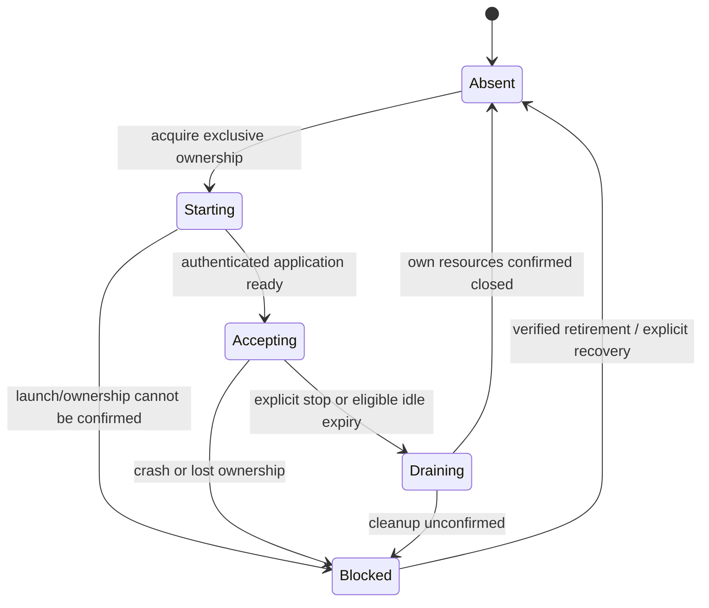

# Resident Huly MCP behind stdio — draft specification

Status: **draft for prototype and lifecycle discussion**, 2026-10-17. Tracks [#321](https://github.com/dearlordylord/huly-mcp/issues/321). This records requirements and research; it does not approve a production supervisor, locking algorithm, timeout policy or state-machine library. [Pinned research and peer incidents](verification/startup-production-321/RESIDENT-DAEMON-RESEARCH.md) remain the source evidence. Correct this specification as useful findings change; do not append a chronological diary.

## Problem and scope

A stdio host currently launches one complete Huly MCP process per connection. Each owns a model/client. Ten concurrent connections duplicate expensive initialization and memory. Preserve ordinary stdio configuration while allowing compatible connections to share heavy backend resources. Retain direct HTTP and standalone stdio behavior as explicit alternatives. Deliver any adapter and resident backend in our package; no third-party application, global service installation, administrative rights or Codex configuration rewrite is a prerequisite.

Initial candidate: one stdio adapter per host connection, communicating through loopback HTTP with a resident Huly backend per compatible resolved configuration, under one OS user. Reuse our native HTTP path. Do not multiplex all hosts onto one upstream stdio transport. Process-memory reduction, broad minimum-model capabilities and persistent model caching are deferred.

## Evidence and limits

The [matched transport comparison](verification/startup-production-321/TRANSPORT-COMPARISON.md) passed18/18 fleets, with three repeats per configuration/concurrency cell. Ten-client median full-model readiness was8.83s for stdio and2.89s for shared environment-backed HTTP. Post-read summed server RSS was5.06 versus0.57GiB. This is warm-cache local SDK evidence, not a Codex UI SLA or physical/peak-memory measurement. **0.57GiB excludes ten proposed adapter processes**. Header-isolated HTTP reacquires model clients and does not reproduce shared-mode behavior. Identical read workloads in that comparison do not establish adversarial response-routing isolation.

No automatic daemon lifecycle or native Windows implementation is qualified by these results. Existing release-qualification failures remain separate; this specification does not close them.

## Terminology and ownership

- **Adapter:** one host's stdio endpoint; owns only its host protocol context, outstanding requests and attachment to a backend generation.
- **Resident backend:** HTTP listener plus compatible Huly resources. Survives an individual adapter's exit.
- **Compatibility identity:** parsed, resolved connection and policy inputs used to decide whether resources may be shared. Not a profile display name or a public credential hash.
- **Generation:** fresh identity for one backend lifetime. Prevents stale adapters/status/cleanup from acting on its replacement.
- **Attachment/lease:** a backend-recognized adapter relationship with release/crash-expiry semantics. Not an indefinitely incremented integer counter.
- **Request identity:** scoped to originating adapter/request context, even if another adapter uses the same JSON-RPC ID.
- **Unknown outcome:** work may have been dispatched/committed, but no authoritative final outcome is available. Distinct from refusal before dispatch.

Backend ownership grants authority to publish/remove the locator, admit work and drain that generation. It does not grant authority to kill any process at a recorded PID or occupied port. One adapter cannot stop a shared backend merely because its own call failed.

## Behavioral requirements

### Configuration, credentials and exposure

R1. Resolve the caller's intended profile/environment at the existing boundary before choosing a backend. Never silently fall back to the first launcher's Huly identity. Profile logout/rotation and configuration changes must have defined invalidation/separation behavior.

R2. Sharing must account for URL, workspace, auth method and credential identity/generation, plus effective connection settings and process-wide policy compatibility. `TOOLS`, `TOOLSETS`, `HULY_TOOL_MODE`, `PROXY_OUTPUT_STRICT` currently affect process configuration. Either separate incompatible policies initially or explicitly authorize immutable per-client views. Timeout reconciliation remains an open choice.

R3. Preserve the real host's clientInfo, capabilities and negotiated protocol semantics. Auto exposure depends on client identity; a generic adapter identity must not silently change native/proxy tools. Tool advertisements and invocation permissions must agree.

R4. Keep local daemon authorization distinct from Huly authorization. Protect secrets with the existing typed/redacted boundaries; no raw secrets in argv, URLs, locator/status data, logs or public identifiers. Do not send Huly header overrides on every call and claim model sharing: our current override path intentionally acquires a request-scoped client. It accepts token credentials, not password/email headers.

### Startup, discovery and attachment

R5. Independent simultaneous launchers for the same compatible identity converge on one admitted backend generation. Coordination covers automatic and explicit launch entrypoints. A killed launcher must not leave permanent ownership or publish a half-ready backend.

R6. Bind an explicit loopback address. Allocate/bind without a free-port check race. Publish an atomic, schema-decoded, versioned locator only after the backend can satisfy its application-level attachment contract. An open TCP port alone is insufficient. MCP catalog availability and full Huly-model readiness are separate milestones; attachment/discovery need not await the model.

R7. Authenticate attachment and verify the expected backend/generation before trusting replies or transferring credentials. Port/PID existence is insufficient identity evidence. Make internal authorization mandatory for managed mode; validate Host/Origin under an explicit local policy. Random ports are not authorization. The mutual-authentication/handoff mechanism is an open design decision.

R8. Treat stale metadata, unreadable ownership evidence, corrupt files, PID reuse and an occupied foreign port explicitly. Do not signal an unrelated process or remove another generation's locator/lock. Bounded failure must be actionable; do not spin or launch unbounded fallback backends.

### Calls, cancellation and failure

R9. Requests, final replies, errors, progress and supported client-directed interactions remain scoped to their originating adapter. Independent clients may reuse IDs. Modern2026 requests do not invent durable protocol sessions; legacy behavior is negotiated explicitly. Preserve supported continuation state; do not advertise features the adapter cannot forward.

R10. Adapter EOF/death and cancellation release or cancel only that adapter's work. A waiting caller's cancellation must not destroy initialization needed by other callers. Late callbacks/results from an obsolete generation cannot publish into its replacement.

R11. A disconnect, timeout or process death after dispatch yields an unknown outcome when appropriate. No automatic replay of uncertain writes. A retry requires proven non-dispatch or explicit operation-specific idempotency/reconciliation. Reconnecting does not provide exactly-once execution.

R12. Closing a downstream reader and slow stdout must not leak requests or stall other clients indefinitely. Propagate transport failures; maintain bounded request concurrency, queueing, message sizes and shutdown waits. Numerical limits must be selected and measured, not invented here.

### Idle, drain, recovery and upgrades

R13. Admit requests only to an accepting authenticated generation. Idle expiry and attachment/request admission need a defined ordering so a new call cannot race shutdown. Queued/active work prevents ordinary idle retirement. Loss of an adapter must not leak a permanent lease.

R14. Drain closes new admission before closing resources. Existing calls finish or receive a defined bounded shutdown outcome. Whether an uncertain operation blocks automatic retirement is an explicit policy decision; do not silently equate timeout with absence of work.

R15. Crash recovery must account for owned descendants and unresolved requests, not just a dead daemon PID. Conservative refusal and verified automatic retirement are alternatives to evaluate. Incomplete cleanup must not silently permit overlapping owners.

R16. Compatibility negotiation includes daemon wire contract and implementation/version identity. Upgrading one adapter must not kill another version's in-flight work. Choose coexistence per compatible version or coordinated migration explicitly; no automatic destructive takeover.

### Platforms and delivery

R17. Qualify macOS, Linux and Windows lifecycle behavior natively. Loopback HTTP portability is not proof of process launch, detachment, ACL or cleanup portability. Avoid shell/package-manager wrappers for launching our own installed entrypoint. Native credential storage currently covers macOS/Linux; supported Windows file/environment paths and new local-token protection must be stated accurately.

R18. No background OS service is installed by a prototype. Startup/stop/status diagnostics must distinguish adapter, backend generation, model readiness and unknown operations without exposing credentials or business payloads.

## Lifecycle model to explore

A state machine describes legal decisions; it does not itself implement cross-process exclusivity. The same model can be implemented by a pure reducer/transition table or a library. File/OS locking, authenticated network exchanges, process launch and cleanup are effects whose results return as events. A lock remains necessary even with a perfectly typed in-process machine.

These are proposed backend states, not an approved complete machine. Model readiness is an orthogonal resource state: cold/acquiring/ready/failed. Adapter attachment is another lifecycle: locating/waiting/attached/released/failed. Requests independently track queued/dispatched/completed/canceled/unknown. Avoid a single enum combining every possible product of these states. An adapter's exit is not a backend stop event.

Prototype question: can two adapters share one generation while admission, per-adapter cancellation, uncertain writes and drain remain separate? Use a deterministic in-memory model to expose illegal transitions first. This is not a distributed-lock proof or a process/network benchmark. The provisional conservative model may block retirement while an outcome is unknown; compare that choice before implementation.

## Alternatives for discussion

| Choice | Benefit | Cost or unresolved obligation |
| --- | --- | --- |
| Pure transition function plus Effect shell | Small dependency surface; transitions inspectable and deterministic | Must explicitly own event serialization, cancellation, timers and effect completion |
| Statechart library for the same lifecycle | Useful for parallel states, invoked work and visualization | New abstraction/dependency; does not replace lock/auth/process ownership; not selected |
| Explicitly started HTTP daemon | Simplest lifecycle; already measured backend sharing | User manages startup/restart; not transparent stdio behavior |
| Own stdio adapter with automatic daemon lifecycle | Preserves stdio host setup and shares heavy resources | Requires R1–R18 and measured adapter overhead |
| OS service manager | OS handles restart/login lifecycle | Platform-specific installation, packaging and ownership; optional future path |
| Universal per-user broker with configuration views | Can share several backends behind one owner | Much broader authority, policy and migration surface; unnecessary initial default |
| Existing standalone stdio | No shared process manager | Repeated model/process cost; remains an explicit fallback |

No library or lock primitive is selected. Study MCPorter's ownership patterns; do not copy every behavior, especially its manual crash-recovery policy and differing Windows cleanup paths. Supergateway's backend-per-client/request modes are not equivalent to shared heavy Huly resources.

## Discriminating acceptance matrix

All cases below are **required evidence to plan**, not passing results.

| Case | Observable requirement | IDs |
| --- | --- | --- |
| Ten adapters from separate parents; explicit launch races automatic launch | One admitted compatible generation; losing launchers retire their own resources | R5–R8 |
| Launcher dies before/after publication; port binds before route ready | Bounded recovery; no half-ready attachment; model remains independently lazy | R5–R8 |
| Stale/corrupt locator, reused PID, foreign listener, stale generation cleanup | No foreign signal/credential handoff; no deletion of replacement state | R7–R8,R16 |
| Two callers use identical IDs with deliberately different reads | Replies/progress/cancel route only to origin | R9–R10 |
| Adapter dies during wait/read/write; another remains active | Other caller survives; uncertain writes are not replayed | R10–R11,R13 |
| Daemon dies after write dispatch, before response | Unknown outcome retained; recovery requires reconciliation, not blind retry | R11,R15 |
| Idle expiry races new attachment/call; queued/active work exists | Ordered admission/drain; no accepted work lost to ordinary idle stop | R13–R14 |
| Slow/closed stdout, excessive concurrency, large replies | Explicit bounds; per-client cleanup and failure propagation | R12 |
| Changed profile, credentials, logout, workspace or tool policy | No cross-identity fallback or broader permissions | R1–R4 |
| Old/new package generations overlap | Defined coexistence/migration; no destructive takeover | R8,R16 |
| Windows/Linux/macOS actual process and file behavior | Native evidence, protected local token, owned cleanup; no inferred Windows pass | R17–R18 |
| Adapter import boundary and ten-adapter memory/startup | Total including adapters measured; no daemon-only memory claim | R18 |

## Open decisions and next prototype stages

1. Exact compatibility identity and secret-safe comparison; credential handoff/profile rotation policy.
2. Locator location and authentication; host launch lock/ownership primitive and recovery rules.
3. Idle lease/heartbeat policy, numerical budgets and whether unknown outcomes block retirement.
4. Upgrade coexistence versus coordinated migration; protocol revision compatibility.
5. Pure transition module versus a statechart library. Decide from actual complexity; neither is a prerequisite for discussing the model.

Stage A is an isolated interactive logic prototype with visible state and guided failure paths. Stage B, after discussing ownership, uses actual separate processes, loopback HTTP, private scratch state and owned cleanup to test R5–R16. Stage C uses the real packaged MCP read path, all adapters included in memory accounting, and native platform verification. No stage may claim evidence belonging to a later one. Keep executable prototypes on a throwaway branch; the main branch retains this specification and evidence pointers. Retire prototype executables when a production implementation supersedes them.
