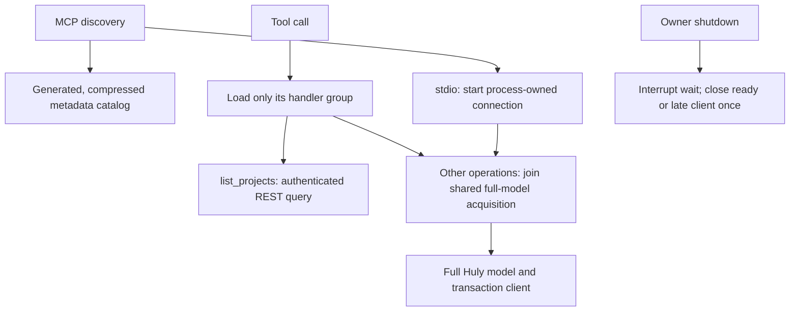

# MCP startup implementation and verification

Implementation for [#321](https://github.com/dearlordylord/huly-mcp/issues/321), prepared in PR #320. Production source replaces the experimental transformations. The user subsequently authorized delivery to master, the next version bump and full integration qualification. One-off executable prototypes and generated experimental bundles have been removed; measured design comparisons remain. npm publication and Codex configuration changes are outside this delivery.

## Implemented design

Catalog generation uses the eager authoring registry as its source of truth. `pnpm verify-tool-catalog` decodes the generated catalog and compares exact metadata, plus the generated group loaders. Semantic comparison permits different gzip encodings across Node versions without accepting stale schemas. Normal discovery does not execute handlers. `MCP_PRELOAD_TOOLS=true` loads all groups before serving, for import qualification. Schema imports use defining modules at the changed runtime sites.

Stdio discovery starts process-owned client acquisition without awaiting it. HTTP credential-header clients and one-shot CLI commands initialize the full model on demand. Environment-backed HTTP clients retain a shared process owner. Transport defaults and credential isolation remain unchanged. Multiple stdio processes still have separate models; this change does not combine ten host-launched instances.

The project-list adapter reuses authenticated workspace discovery and the SDK REST client, preserving filtering, sorting, limits, total handling, and schema parsing. It is deliberately restricted to project summaries. Concrete MCP resource enumeration consumes the same project operation. All other operations keep the full model; globally disabling it changes notification/workbench metadata and is not supported.

Full-model acquisition is single-flight per connection owner. Individual cancellation stops waiting without cancelling shared work or replaying mutations. Failed acquisition invalidates the shared result; later calls may retry, with the existing bounded transient connection retries. Endpoint/token rediscovery updates both the full connection used by writes/markup and the lightweight project route. Handler import failures remain cached and return sanitized restart/reinstall guidance.

Pending SDK creation is owned before waiting: shutdown can interrupt the wait and return without waiting for an unresolved SDK promise. If that promise later produces a client, the owner closes it once instead of publishing it. Promise rejections, including late cleanup rejection, are observed. A ready client's normal finalizer awaits cleanup. The SDK itself does not offer cancellation of the underlying model fetch; cancellation of the Effect wait is not a claim that remote work is aborted.

## Measurement boundaries

Compare the original PR #320 build (`93856079`) with the production build using fresh stdio processes and local Huly. Keep native and auto/proxy results separate. Exact catalog and response comparisons retain business data only in memory; saved evidence contains timings and process counters only. Three samples per cell describe this machine, not an SLA.

The default MCP SDK client compiles every cached output schema on its first `callTool`, before sending the request (`@modelcontextprotocol/client/dist/index.cjs`, output-validator cache and `callTool`). Native mode exposes 604 operations, whereas proxy mode exposes a small catalog. This client-side first-call cost persists after an idle pause and must not be attributed to Huly model initialization. A separate measurement supplies the called tool's listed definition to retain output validation without compiling unrelated schemas. Neither measurement establishes Codex desktop end-to-end latency.

## Validation status

Current version bump, exact-artifact comparison, actual Codex checks and all full-suite outcomes are recorded in [release qualification](RELEASE-QUALIFICATION.md). Full release qualification retains failures; the earlier measurements below do not supersede them.

Focused lifecycle, metadata, projects, recovery and lazy-handler checks pass. The complete quality gate and final build measurements are recorded below. No quality threshold, timeout, expected catalog, or external dependency inventory has been relaxed.

The local-Huly comparison is read-only. Whole-server/CLI mutation campaigns and actual Codex host qualification are completed with outcomes recorded in the linked release report. An earlier native integration run reached 102 passing checks before being stopped on an older candidate; it is not final integration evidence.

## Review

Separate Standards and Spec reviews covered the complete candidate against PR base `90b70006`, including untracked implementation files. Both initially identified a stale lightweight endpoint after recovery; Standards also found an untyped lazy context-construction failure, and Spec found uninterruptible pending model acquisition. The implementation and regression tests were corrected. Final follow-up reviews reported zero remaining findings on both axes. Valid HTTP SSE notifications are permitted in the bare legacy-call test, while exactly one schema-decoded response, the original request ID, error checks and lease cleanup remain required.

## Packaging

The generated metadata catalog occupies 194,633 bytes compressed instead of about 2.54 MB uncompressed. The final bundled MCP is 8,778,183 bytes and the CLI is 8,412,327 bytes. Packed MCP certification confirms exactly four files, executable mode 0755, the pinned patched Effect cohort, and external modules `@napi-rs/keyring`, `dbus-next`, `ws`. CLI artifact evidence remains under the unchanged 10% material-increase budget (package +8.90%, raw bundle +3.55% against its established certification baseline). Gzip/package evidence uses Node 24.14.0; latency comparisons use Node 25.6.1 consistently for both candidates.

CLI `projects list --json` succeeded against local Huly and returned all eight project summaries. No mutation was issued by this probe.

The explicit preload smoke also succeeds with an unreachable Huly endpoint: all handler imports load and the native catalog exposes 606 tools (604 Huly operations and two built-ins). Catalog availability is independent of backend readiness. The held-network regression verifies discovery with both 2025-06-18 and 2026-07-28 protocols.

## Final quality gate

`pnpm check-all` passed on the final production source: 427 test files, 5,498 tests. V8 coverage: statements 99.46%, branches 99.00%, functions 99.01%, lines 99.55%. The gate also passed the build, TypeScript/Effect diagnostics, dependency-cycle check, complexity limit, schema boundaries, registry/readme/CLI synchronization, package closure, lint and duplication checks. Successful output stayed within its budget (184/300 lines).

A preceding run hit a macOS `EPERM` while proving cleanup of a test-only resistant process group. The unchanged harness then passed all 11 focused tests and the complete gate passed. This is not reported as a product failure or hidden by a platform skip; process cleanup checks remain enabled.

## Final production measurements

Fresh processes, Node 25.6.1, local Huly and warm filesystem caches; no concurrent quality campaign. Node executes the existing bundled artifact directly: package download, npx resolution and Codex desktop startup are excluded. Medians of three matched samples per cell, milliseconds. `pause` begins after catalog discovery.

| Client mode | Pause | Catalog baseline | Catalog production | First project call baseline | First project call production |
| --- | --- | ---: | ---: | ---: | ---: |
| auto | 0 ms | 740 | 551 | 1321 | 79 |
| auto | 2000 ms | 723 | 565 | 1286 | 62 |
| native | 0 ms | 840 | 698 | 1962 | 1141 |
| native | 2000 ms | 855 | 715 | 1992 | 724 |

Default SDK timings include its native catalog-wide first-call output-validator compilation. When supplying only the called tool’s listed definition (same response validation), native timings are:

| Pause | First project call baseline | First project call production |
| --- | ---: | ---: |
| 0 ms | 1307 | 33 |
| 2000 ms | 1259 | 44 |

All 36 stdio samples passed exact native/proxy catalog, project-result, eight-resource-count and authoritative notification-provider/workbench-result comparisons. These checks do not certify every mutation operation.

Baseline post-read RSS: median 553.9 MiB, range 550.1–556.6 MiB. Production post-read RSS: median 555.5 MiB, range 554.1–562.1 MiB. Snapshots occur after full-model metadata reads; they are not peak-memory measurements. There is still a per-process memory cost, so ten stdio instances remain much more expensive than one shared process.

HTTP request context 1: project-call median 90 ms, range 86–94 ms across three servers. HTTP request context 2: project-call median 44 ms, range 41–65 ms across three servers. HTTP request context 3: project-call median 321 ms, range 69–343 ms across three servers. All nine contexts succeeded. Each server received a fixed 1.5-second readiness allowance, excluded from catalog/call timing; this is not an HTTP-vs-stdio end-to-end startup comparison. Background model parsing is a possible source of foreground contention, but this measurement does not isolate the cause of the HTTP tail. The observed tail is retained rather than presented as a latency guarantee.

The recommended production default is lazy handlers plus background full-model initialization, with a narrowly qualified light project read. Full handler prewarming remains an explicit smoke option, and shared HTTP remains an opt-in way to amortize independent host contexts. No automatic transport/configuration conversion or model-fidelity reduction is included.
